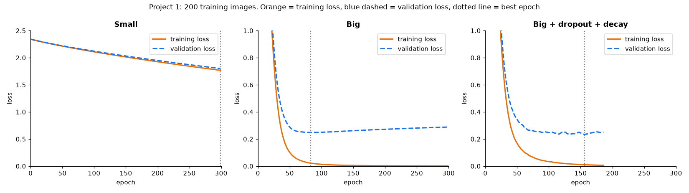

# Project 1 results: which model ships?

                Model  Final training loss Best validation loss  Epochs run  Test accuracy
                Small                1.767   1.800 at epoch 300         300          0.751
                  Big                0.001    0.248 at epoch 84         300          0.934
Big + dropout + decay                0.006   0.234 at epoch 157         187          0.937

**Decision:** Ship the regularised model (big + dropout + decay): it has the lowest validation loss (0.234 at epoch 157) and it stopped itself 113 epochs early. Its test accuracy is only 0.3 points better than the plain big model, so the most help now is more labelled data: 200 images is the real limit.
